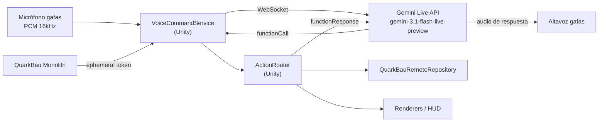

# Roadmap & Future Features - Horizon-Faser

Este documento contiene propuestas de arquitectura y diseño para llevar la aplicación de Realidad Mixta de Horizon-Faser al siguiente nivel (Enterprise / Industria 4.0), mejorando la eficiencia de los técnicos en campo y la integración con el ecosistema Quarkbau.

> **Estado actual (Oct 2026):** La app es un *visor AR de planificación* sólido (segmentos, crews, POPs/NVTs, utilities en Cesium). Lo que falta es el *ciclo de captura*: **gafas capturan → IA valida → HUD confirma**, que es el núcleo de la visión descrita en `Glasfaser/ARCHITECTURE_AR_VISION.md`.

---

## 0. Prioridades Inmediatas (Gaps Críticos)

| Prioridad | Tarea | Estado actual |
|---|---|---|
| 🔴 | **Captura POV + IA de Visión:** foto/ráfaga + GPS → Monolith → `/api/v1/analyze/trench` y `/analyze/cable` | No existe código de cámara ni de llamadas al AI Vision Service |
| 🔴 | **HUD de Confirmación:** feedback ✅/❌ ("Zanja aprobada" / "Repetir toma") | No existe |
| 🔴 | **UI de Acciones de Campo:** cambiar estado de segmento y reportar incidentes | `UpdateSegmentStateAsync` y `ReportIncidentAsync` existen en el repositorio pero **ninguna UI los llama** |
| 🟠 | **Login Real:** eliminar el login mockeado de `QuarkBauRemoteRepository.LoginAsync` | El token es falso |
| 🟠 | **Cola Offline de Escritura:** encolar fotos, cambios de estado e incidentes sin conexión | Solo hay caché de lectura y un `SyncManager` básico |
| 🟡 | **Datos Reales de Crews/Máquinas** | `SegmentRenderer` aún usa datos mock |
| 🟡 | **Altura Precisa sobre el Terreno:** usar `SampleHeightMostDetailed` de Cesium y calibración persistente | Todos los nodos se anclan a altura `0` |
| 🟡 | **Privacidad (GDPR / Betriebsrat):** ofuscar caras y matrículas en las capturas antes de persistirlas | No existe (debe ir en AI Vision Service o en el móvil) |

---

## 1. Asistente de Voz con IA (Comandos → Acciones)

Con guantes y dentro de una zanja, la voz es la interfaz natural. Actualmente **no existe** ningún componente de micrófono, STT ni parser de intenciones.

### 1.1. Arquitectura propuesta

*   **Multilingüe nativo:** el modelo detecta y cambia de idioma automáticamente (~70 idiomas). Un obrero polaco o rumano habla en su idioma y se ejecuta la misma acción.
*   **Intención, no frases exactas:** "listo este tramo", "terminado aquí" o "fertig" → `update_segment_state(DONE)`.
*   **Respuesta hablada:** "Tramo 14 marcado como terminado" — sin necesidad de mirar un panel.
*   **`ActionRouter` único:** botones, gestos y voz llaman a las mismas acciones (desacopla la UI de la lógica).

### 1.2. Catálogo de Tools (Function Calling)

| Comando hablado (ejemplo) | Tool | Acción en Unity |
|---|---|---|
| "Capturar zanja" | `capture_trench()` | Foto + GPS → Monolith → `/analyze/trench` → HUD ✅/❌ |
| "Tramo terminado" | `update_segment_state(state)` | `UpdateSegmentStateAsync` |
| "Aquí hay una tubería de gas" | `report_incident(type, severity)` | `ReportIncidentAsync` + Spatial Anchor |
| "¿Dónde está el NVT más cercano?" | `find_nearest_node(type)` | Cálculo de distancia + highlight en Cesium |
| "Muestra gas y electricidad" | `toggle_layer(layer, visible)` | Activar/desactivar capas de `UtilityRenderer` |
| "¿Qué profundidad lleva este tramo?" | `get_segment_info()` | Lee datos del segmento → respuesta hablada |
| "Abre el permiso" | `open_permit()` | Abre el PDF en `NodeInfoCardUI` |

### 1.3. Decisiones de diseño

*   **Seguridad:** la API key **nunca** va en el APK. El Monolith emite *ephemeral tokens* a gafas autenticadas (requiere login real).
*   **Sin SDK oficial C#:** implementar con `System.Net.WebSockets.ClientWebSocket` siguiendo el protocolo raw del Live API, o usar la app Flutter como puente.
*   **Confirmación de acciones críticas:** "aprobar tramo" o "cerrar incidente" requieren confirmación verbal ("¿Confirmas? Di *sí*"), ya que tienen valor documental (DIN 18220).
*   **Fallback offline:** reconocedor on-device (Vosk o Android `SpeechRecognizer`) con gramática cerrada de 5–10 comandos críticos, encolados en `SyncManager`.
*   **Batería y Betriebsrat:** nada de micrófono abierto 24/7. *Push-to-talk* (botón o gesto de pinch) o *wake-word* local ("Horizon…"); el audio solo se envía tras la activación.

### 1.4. Fases

1.  **MVP:** push-to-talk → Gemini Live → 3 tools (`update_segment_state`, `report_incident`, `toggle_layer`) → respuesta hablada + toast en HUD.
2.  Endpoint de *ephemeral tokens* en el Monolith + login real.
3.  `capture_trench` conectado al AI Vision Service.
4.  Fallback offline con gramática cerrada.
5.  Wake-word y confirmaciones.

---

## 2. Interacciones XR y Realidad Aumentada Avanzada

*   **Visión de "Rayos X" Subterránea:** 
    Aprovechando el *Passthrough* de Meta Quest 3 y las coordenadas de Cesium, implementar un *shader* especial en el suelo virtual. Esto permitiría al técnico mirar al asfalto de la calle y "ver debajo de la tierra" por dónde pasan exactamente los conductos, las *Muffes* (cajas de empalme) y las conexiones hacia el *HÜP* (Punto de entrega).
*   **Interacción Directa con Manos (Hand Tracking):** 
    En lugar de depender únicamente de los controladores y punteros (`XRPointerMagnet`), implementar interacciones físicas usando Meta XR y XR Interaction Toolkit: agarrar y mover un holograma de un *Netzverteiler* o hacer gestos de *Pinch-to-zoom* sobre el mapa de la ciudad.
*   **Menús Diegéticos (Wrist UI):** 
    Eliminar interfaces flotantes clásicas (paneles de Dashboard que bloquean la vista) y cambiarlas por menús holográficos que se desplieguen directamente en la muñeca o en la palma de la mano del técnico.
*   **Herramienta de Medición Espacial (AR Ruler):** 
    Función para marcar dos puntos físicos en el mundo real (ej. desde el HÜP hasta la acera) para que la app calcule instantáneamente los metros de cable o zanja que se necesitan.

## 3. Flujos de Trabajo de Campo y Negocio (Fieldwork)

*   **Soporte Offline Robusto (Sincronización Local):** 
    Implementar SQLite o Realm local. El técnico descarga los datos del *Cluster* asignado en la oficina, va al campo (sótanos o zanjas sin internet), trabaja en modo offline, y la app sincroniza automáticamente los cambios (`QuarkbauProject`, incidentes, etc.) al recuperar la conexión.
*   **Reporte de Incidentes con Anclajes Espaciales (Spatial Anchors):** 
    Permitir anclar un "holograma de alerta" permanentemente a las coordenadas exactas de un problema en la calle (usando `SpatialAnchorManager`), adjuntando fotos o audios. El siguiente equipo verá un ícono flotando exactamente donde está el problema físico.
*   **Asistente Holográfico de Empalmes (Splicing Guide):** 
    Al acercarse a un *Netzverteiler* o *Muffe*, la gafa superpone guías de colores indicando al operario qué cable empalmar con cuál (ej. *"El cable azul va al puerto B"*), reduciendo errores humanos.

## 4. Colaboración e Integraciones

*   **Asistencia de Experto Remoto (See-What-I-See):** 
    Integrar un protocolo de baja latencia (WebRTC, Agora o Photon). Un técnico novato llama a soporte; el ingeniero ve la cámara de la Quest 3 desde el `web-dashboard` y puede dibujar marcas en la pantalla web que aparecen en el mundo AR del técnico.
*   **Capas GIS Multidisciplinares (WMS/WFS):** 
    Agregar capas geográficas para mostrar instalaciones públicas de agua, gas y electricidad superpuestas en Cesium, previniendo cortes accidentales al excavar.

## 5. Pulido Arquitectónico (Código y Rendimiento)

*   **Agrupación Geométrica (Clustering / LOD) Dinámica:** 
    Sistema para agrupar marcadores lejanos (cuando un *Cluster* tiene miles de nodos) en un solo punto, separándolos a medida que el usuario se acerca, para mantener un rendimiento óptimo de FPS en las Quest 3.
*   **Sistema de Inyección de Dependencias (DI):** 
    Usar frameworks como *Zenject / Extenject* o *VContainer* para el manejo de repositorios (como `QuarkBauRemoteRepository`), autenticación y controladores de UI, haciendo el proyecto altamente modular y testeable.
*   **Configuración Centralizada por Entorno:** 
    La IP `192.168.178.57` está hardcodeada en ~5 sitios (`NodeInfoCardUI`, `LoginUIController`, `DashboardUIController`). Crear un `ScriptableObject AppConfig` (dev / staging / prod) como única fuente de URLs.
*   **Descomponer "God Classes":** 
    `NodeInfoCardUI` (~1100 líneas, construye UI por código) y `DashboardUIController` (mezcla UI, fetching, cálculo de distancias y orquestación de render). Separar en vistas (prefabs/UI Toolkit) + servicios.
*   **Estado Global de Sesión:** 
    Sustituir los múltiples `FindObjectOfType` y casts directos a `QuarkBauRemoteRepository` por un `ProjectSession` / `AppState` con eventos (proyecto activo, ubicación, conectividad).
*   **Ciclo de Vida de Renderers:** 
    Los renderers estáticos crean padres y materiales en cada render. Introducir un `SceneContentManager` que limpie/recargue por proyecto, comparta materiales y aplique LOD.
*   **Manejo de Errores Visible:** 
    Eliminar `async void` sin try/catch y dejar de tragar errores como `LogWarning` (así se ocultó el 404 de `/api/projects/{id}/pops`). Propagar errores a la UI.
*   **Contratos de API Generados:** 
    Generar los modelos C# desde el OpenAPI del Monolith para evitar desajustes de endpoints/DTOs entre Unity y Spring Boot.
*   **Tests Automatizados:** 
    Añadir tests (Unity Test Framework) para deserialización, cálculo de distancias y lógica del `ActionRouter`.
*   **Higiene del Repositorio:** 
    Añadir `Assets/_Recovery/` y `.utmp/` al `.gitignore`.

## 6. Estética y UX en AR

*   **HUD Real de AR:** 
    Sustituir los paneles tipo dashboard por un HUD mínimo con *lazy-follow*: estado de conexión, proyecto activo, distancia y semáforo de IA (verde/rojo).
*   **Lenguaje Visual Coherente:** 
    Unificar materiales (hoy se mezclan `Unlit/Color` y URP Lit) y definir una paleta semántica por tipo y estado (planificado, en obra, aprobado, incidente), alineada con el `web-dashboard` Angular.
*   **Escala y Legibilidad:** 
    Reemplazar la escala fija ×30 de POPs/NVTs por escala dependiente de la distancia; etiquetas *billboard* de tamaño constante; oclusión con el entorno real.
*   **Micro-feedback:** 
    Animaciones de aparición, highlight al apuntar, sonido/háptica al confirmar acciones, indicador de carga durante el fetch.
*   **Estados Vacíos y de Error:** 
    Mensajes claros en el HUD: "Sin conexión — usando caché", "Proyecto sin nodos", "Fuera del radio del proyecto".

---

## Orden de Ejecución Sugerido

1.  Configuración centralizada + login real.
2.  UI de cambio de estado e incidentes (los métodos del repositorio ya existen).
3.  MVP del Asistente de Voz (sección 1.4, fase 1).
4.  Captura POV + AI Vision → HUD ✅/❌.
5.  Refactor de `DashboardUIController` / `NodeInfoCardUI` hacia servicios y estado.
6.  Pulido visual, cola offline y fallback de voz.
